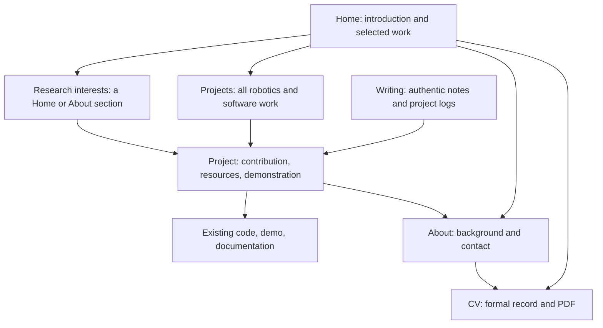

# Functional structure and information architecture audit

Reviewed November 5, 2026. Audience confirmed by the owner: **academic and engineering visitors, with research first**.

Owner clarification, November 5: the research work described on the site has **not yet been submitted**. It should be presented as projects and research interests, without implying papers, submissions, acceptance, peer review, or manuscripts in preparation. A project can have real hardware, code and demonstrations without being a publication. Submission status alone does not establish whether each project is ongoing or complete.

This review follows the performance revision. It evaluates the current local site and real reference websites. Findings below distinguish observed behavior from proposed design changes. This document records recommendations; it does not claim that the proposed restructuring has already been implemented.

## Assessment

The site already has enough page types. The largest opportunity is to connect research interests, representative work, supporting evidence, and contact. The homepage currently doubles as the full project directory, while the Research page supplies too little evidence to fulfill its role. Existing accessible navigation, CV/PDF, stable project URLs, RSS, readable static content, and the lighter wallpaper implementation should remain.

## Reference websites: observed patterns and what transfers

These are selected examples of useful structure, rather than a ranking or a certification of their performance/accessibility. The observations concern the pages inspected on the review date.

| Reference | Observed structure | Application to this site |
| --- | --- | --- |
| [Jon Barron](https://jonbarron.info/) | The introduction is followed by Email, CV, Bio, Scholar and GitHub links. Research entries combine a short contribution summary with project/code/demo resources. | Make the author's work and evidence easy to inspect, with contact/CV available beside the introduction. Preserve the existing portrait and academic layout. |
| [Henrique Ferrolho](https://ferrolho.github.io/) | Projects, Research, Writing and CV have distinct destinations. The homepage connects selected work to a complete project directory. | A strong reference for combining robotics research with engineering tools without making separate personas or duplicate homepages. |
| [Ferrolho's pendulum project](https://ferrolho.github.io/projects/rotary-inverted-pendulum/) | Live demo, video, documentation and source links appear near the title; later sections explain the pipeline and where different readers should start. The bottom provides contact and further navigation. | Give each project a compact, factual resource area and a useful exit after reading. Resources must actually exist. An interactive simulator is unnecessary for this site at present. |
| [Brittany Chiang](https://brittanychiang.com/) and [project archive](https://brittanychiang.com/archive) | The homepage selects a few projects and links to a separate complete archive. Experience, projects and writing have different purposes. | Use the homepage for editorial selection; let Projects retain the complete collection. Borrow the distinction, not the visual theme or framework. |
| [Universal Manipulation Interface](https://umi-gripper.github.io/) | The project groups paper/code/tutorial resources, explains the method, and presents task-specific experiments and comparisons. | Organize robotics detail pages around the problem, contribution, demonstration, and available evidence. Do not imitate the site's scientific claims, experiment scale, or media volume. |
| [Tony Zhao](https://tonyzhaozh.github.io/) and [Mobile ALOHA](https://mobile-aloha.github.io/) | Research is described through concrete robot tasks. The project page distinguishes paper, tutorial, datasets, hardware code and learning code. | Show different resource types explicitly when available; distinguish mechanical, perception, control and software contributions. The personal homepage marks itself as an older academic archive, so it is not a model for current update frequency. |
| [Simon Willison](https://simonwillison.net/), [Tools](https://tools.simonwillison.net/) and [project posts](https://simonwillison.net/tags/projects/) | Writing and working tools have distinct entry points, with project-related articles collected together. | Keep software projects separate from writing; later, link authentic project logs in both directions. The current two posts do not justify multiple feeds, article types, tag archives, or a separate tools subsite. |

The recommendations below are design judgments inferred from those patterns and the site's current content, rather than claims that copying a reference automatically improves usability.

## Confirmed local findings

### 1. Research interests do not lead to project evidence — high priority

Observed path: **Home → research → five interest descriptions → empty publications section → generic Projects link**. None of the five interest entries links directly to an associated project. The only project link on the Research page points to the whole directory.

A visitor evaluating research fit must infer the connections independently. The problem is the missing relationship, not the absence of publications.

Recommendation: add a “Selected work by theme” section using existing material, for example:

- Mechanism design and dexterous manipulation → the underactuated hand and monocular hand retargeting.
- Underwater perception → the robotic fish, with the author's visual-recognition/tracking contribution clearly stated.
- Language-guided robot control → the quadruped demonstration.

Retain all verified research interests separately. An interest without a demonstrated project should remain an interest, rather than being presented as an accomplished research result. For the current stage, put this concise interest-to-project mapping on Home or About; a standalone Research/Publications navigation item is optional and not a priority. Avoid an empty publications section as a focal point. Preserve `/publications/` and `/papers/` for existing links, without presenting the projects as papers. Add a publication/submission record only when the owner supplies its actual status.

Source: [`_pages/publications.html`](../_pages/publications.html), especially its interest loop and empty-publication link; [`_data/profile.yml`](../_data/profile.yml).

### 2. “Selected projects” is the whole directory — high priority

All six projects are featured and use the same chronological ordering as Projects. Hyadex and PaperNAS come first, followed by the four robotics projects. The 304 g hand comes last. This is a reasonable archive order, but it does not express the confirmed research-first goal.

On a 390×844 local browser viewport, the Selected projects heading begins at approximately document y=1637 px and Latest posts at y=4089 px. These are observations of the current layout, not universal screen-depth targets. Homepage biography already contains direct project links, so research work is not wholly inaccessible before the list.

Recommendation: retain a static list, but select around three representative robotics projects with a separate editorial order. An initial evidence-based selection is the underactuated hand (hardware and documented mass), monocular hand retargeting (simulation and public code), and the quadruped (physical demonstration). Keep the fish accessible through the research-interests section and the complete Projects directory. These are editorial suggestions, not a ranking of scientific quality.

Show Hyadex and PaperNAS together in a compact “Research and development tools” area. Keep all six entries in Projects, with their real dates unchanged.

Source: [`_pages/home.html`](../_pages/home.html), [`_includes/selected-project.liquid`](../_includes/selected-project.liquid), project `featured` fields.

### 3. Search misses technologies that the site actually documents — functional defect

Verified in the browser against the current built site:

| Query | Current result | Existing matching content |
| --- | --- | --- |
| HaMeR | No results | Hand-retargeting tags/body |
| YOLOv8 | No results | Robotic-fish tags/body |
| Qwen | No results | Quadruped tags/body |
| FastAPI | No results | Hyadex and PaperNAS tags/body |
| robotic hand | Hand-retargeting project found | Title/description |
| PaperNAS | Projects page and PaperNAS found | Title/description |

The index and matching function currently search only title and description. Add tags, categories and bounded plain-text body content. Rank title matches above tag/body matches and deduplicate results by URL. Keep the current local implementation; no remote search service or language model is necessary for this collection.

Acceptance: the first four queries should find their corresponding projects; ordinary title queries and keyboard navigation must continue to work; indexed text must remain safely serialized.

Source: [`_layouts/default.liquid`](../_layouts/default.liquid), search-data block; [`assets/js/studio.js`](../assets/js/studio.js), `renderSearch`.

### 4. Project evidence and resource links have no consistent location — high priority

The shared detail template places the hero image before the body. Source-code links live inside individual bodies, so visitors to software projects encounter a large screenshot before reaching their source/documentation links. A screenshot-source link also appears separately in the image caption; that attribution is useful but is not equivalent to the project repository.

Recommendation: put existing Code, Demo and Documentation links beneath the title. Only render resources that are present. Keep image attribution in the caption with an unambiguous label. Move the already documented early-development/single-user status of the software tools near the resource area, so readers can decide whether to investigate further.

Use a common reading sequence while allowing different evidence types:

1. Problem and concise result/purpose.
2. Author's role and contribution, where supported by records.
3. Existing resources and current status.
4. Method or system workflow.
5. Demonstration/results with conditions and limits that are actually known.
6. Further work, related project or contact.

No generic “Download” button should be invented when there is no release artifact. A photograph is evidence of an artifact, not proof of a measured result.

Source: [`_layouts/project.liquid`](../_layouts/project.liquid), [`_projects/hyadex.md`](../_projects/hyadex.md), [`_projects/papernas.md`](../_projects/papernas.md), [`_projects/monocular-hand-control.md`](../_projects/monocular-hand-control.md).

### 5. Deep-link visitors have no contact exit after reading — high priority

Project pages can be entered directly from a shared link. The tested Hyadex page has **zero mailto links**, and the shared detail template ends after the article. The site footer contains attribution and RSS only. A Projects return link exists at the top, but not at the end of a long detail page.

The homepage already has accessible Email/GitHub/CV icons and About has a visible, copyable email address; those should remain. Extend that access to deep pages with a small shared footer containing Email, GitHub and CV, and put All projects at the end of project articles. A contact form, booking integration, or new Contact page is unnecessary.

Source: [`_layouts/project.liquid`](../_layouts/project.liquid), [`_layouts/default.liquid`](../_layouts/default.liquid), [`_pages/about.html`](../_pages/about.html).

### 6. “about” names two destinations — medium priority

The navigation label `about` links to `/`, while `/about/` is a separate page titled About. More about me is the bridge between them. The current navigation active state also groups these pages together. This convention is workable, but makes the distinction between homepage, background and formal CV less clear.

Recommended navigation for the current, pre-submission stage:

**Projects · Writing · About · CV**

The name/brand links home. About links to `/about/`; Writing keeps `/posts/`. Research interests can live on Home/About and link to actual project work. Keep the existing research/publication URLs reachable for compatibility, without prioritizing an empty publication destination. No URL migration or extra top-level page is required.

- Home: concise introduction and editorial selection.
- About: context, education, experience, honors and contact.
- CV: formal, printable/downloadable record.

This is a navigation recommendation, not a broken-link finding.

Source: [`_data/navigation.yml`](../_data/navigation.yml), [`_pages/about.html`](../_pages/about.html), [`_pages/cv.html`](../_pages/cv.html).

### 7. Filtering is finer than the collection — medium priority

Six projects have five categories; four categories each contain one project. The two-post Blog also has category filters. These controls work, but currently offer little comparison value.

Use **All / Robotics / Software** as the broad project choices, preserving specific technical categories as metadata and searchable tags. Keep the existing complete project collection. The Blog can use a simple chronological list and RSS until more substantive writing exists.

A second browser observation: **Projects → Software → Hyadex → the page's Projects link** returns to All, with all six projects visible. This tests the site's own return link, not browser Back behavior. A URL query such as `?area=software`, with an appropriate return link, would make a filtered view shareable and restorable. With six projects this is a convenience improvement, below search and evidence access in priority.

Source: [`_pages/projects.html`](../_pages/projects.html), [`_pages/posts.html`](../_pages/posts.html), [`assets/js/studio.js`](../assets/js/studio.js).

## Recommended structure

Suggested homepage sequence:

| Section | Purpose | Scope |
| --- | --- | --- |
| Introduction | Establish identity, research focus and useful next steps | Keep affiliation and portrait; use explicit Projects / CV / Email links |
| Selected robotics work | Demonstrate research direction | Approximately three manually ordered entries, with actual contribution/evidence |
| Research and development tools | Demonstrate software capability without displacing robotics | Compact Hyadex and PaperNAS entries |
| Experience | Give institutional context | Short entries, with full context in About/CV |
| Writing | Offer material worth reading | Existing posts remain available; do not label introductory posts as research results |
| Contact | Support the next action | Visible email, GitHub and CV |

## Implementation order and acceptance

| Order | Work | How to judge completion |
| --- | --- | --- |
| 1 | Fix technical search and standardize project resources/contact | HaMeR/YOLOv8/Qwen/FastAPI find relevant projects; direct project visitors can reach existing source/demo/contact without hunting |
| 2 | Connect research interests to existing projects on Home/About; curate the homepage | A visitor can follow an interest to an actual artifact in one click; homepage selection differs intentionally from the archive |
| 3 | Clarify navigation and simplify filters | Every navigation label has one clear destination; complete collection and stable routes remain available |
| 4 | Add evidence from the owner's actual records | Each substantial claim can be understood with its role, conditions and limits; no fabricated benchmarks or dates |

Minimal data changes would be an independent homepage order, a broad project area, and a structured list of existing resource links. Do not build a general CMS or change the static-site stack for six projects. Keep the profile, approved CV and PDF aligned when personal facts change.

Preserve the preceding revision's resource budget, optional solid mode, restrained landscape presentation, no autoplay, keyboard behavior, mobile layout, reduced-motion/transparency support, and print readability. Any future implementation should repeat the relevant browser checks; this audit itself changes no production UI.

## What is not justified yet

- More top-level sections with no substantive content, including a separate news feed or empty research subpages.
- Accounts, dashboards, comment systems, complex contact forms, recommendation engines or semantic search.
- A live 3D scene, autoplaying research gallery, or third-party embeds merely to imitate a reference site.
- Scholar/ORCID/LinkedIn links that the owner has not supplied, invented publication cards, unsupported project status or metrics.
- A second full biography, duplicated project archive on the homepage, or separate academic/engineering versions of the site.

The highest-value additions are navigable evidence and one substantial project log, not more interface components.
